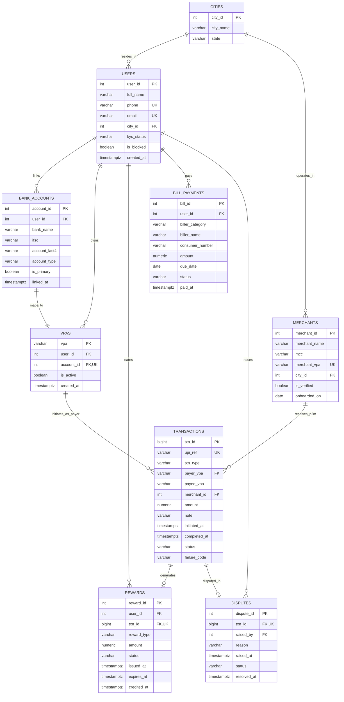

# Phase 2: Schema Design, Normalization & Integrity Report

**Project:** Google Pay (UPI) Digital Payments Database System  
**Course:** Database Management Systems (DE Project 2026) · **Team No.:** T0009  
**Team Members:** Tejas Gupta (Lead), Priyank Gurnani, Parth Saklani, Parth Kumawat  
**Database:** PostgreSQL 15+ · **Schema Name:** `gpay`  

---

## 1. Complete Data Dictionary

### 1.1 Table: `cities`
Master reference table storing Indian administrative cities and states.

| Column | Data Type | Constraints | Business Justification / Description |
|---|---|---|---|
| `city_id` | `INT` | `PRIMARY KEY` | Unique surrogate city identifier. |
| `city_name` | `VARCHAR(100)` | `NOT NULL` | Full name of the metropolitan city (e.g., Bengaluru, Mumbai). |
| `state` | `VARCHAR(100)` | `NOT NULL` | State or union territory name for regional reporting. |

---

### 1.2 Table: `users`
Registered Google Pay consumer profiles.

| Column | Data Type | Constraints | Business Justification / Description |
|---|---|---|---|
| `user_id` | `INT` | `PRIMARY KEY` | Unique internal identifier for the consumer. |
| `full_name` | `VARCHAR(150)` | `NOT NULL` | User legal name for UPI registration and KYC audits. |
| `phone` | `VARCHAR(15)` | `NOT NULL, UNIQUE, CHECK (~ '^[0-9]{10}$')` | 10-digit Indian mobile number; primary login credential. |
| `email` | `VARCHAR(255)` | `UNIQUE, CHECK (email IS NULL OR email ~ '^[^@]+@[^@]+\.[^@]+$')` | Optional user email address for e-receipts and statements. |
| `city_id` | `INT` | `NOT NULL, REFERENCES cities(city_id) ON DELETE RESTRICT` | User residency location; restricted from deletion to prevent orphaned profiles. |
| `kyc_status` | `VARCHAR(20)` | `NOT NULL, DEFAULT 'PENDING', CHECK (IN ('PENDING', 'VERIFIED', 'REJECTED'))` | RBI KYC verification status governing transaction limits. |
| `is_blocked` | `BOOLEAN` | `NOT NULL, DEFAULT FALSE` | Flag indicating fraud suspension or user deactivation. |
| `created_at` | `TIMESTAMPTZ` | `NOT NULL, DEFAULT CURRENT_TIMESTAMP` | Onboarding timestamp with timezone (+05:30). |

---

### 1.3 Table: `bank_accounts`
Bank accounts linked by users through NPCI bank integration.

| Column | Data Type | Constraints | Business Justification / Description |
|---|---|---|---|
| `account_id` | `INT` | `PRIMARY KEY` | Unique surrogate identifier for the linked account. |
| `user_id` | `INT` | `NOT NULL, REFERENCES users(user_id) ON DELETE CASCADE` | Owning consumer. Cascades when user profile is deleted. |
| `bank_name` | `VARCHAR(100)` | `NOT NULL` | Issuer bank name (e.g., HDFC Bank, ICICI Bank, SBI). |
| `ifsc` | `VARCHAR(11)` | `NOT NULL, CHECK (~ '^[A-Z]{4}0[A-Z0-9]{6}$')` | 11-character statutory RBI IFSC code. |
| `account_last4`| `VARCHAR(4)` | `NOT NULL, CHECK (~ '^[0-9]{4}$')` | Masked bank account last 4 digits for UI display. |
| `account_type` | `VARCHAR(20)` | `NOT NULL, DEFAULT 'SAVINGS', CHECK (IN ('SAVINGS', 'CURRENT'))` | Account category determining overdraft and withdrawal limits. |
| `is_primary` | `BOOLEAN` | `NOT NULL, DEFAULT FALSE` | Designates primary debit account for outgoing UPI payments. |
| `linked_at` | `TIMESTAMPTZ` | `NOT NULL, DEFAULT CURRENT_TIMESTAMP` | Timestamp when user linked account via NPCI OTP/SMS flow. |

---

### 1.4 Table: `vpas`
Virtual Payment Addresses (UPI IDs) mapped to linked bank accounts.

| Column | Data Type | Constraints | Business Justification / Description |
|---|---|---|---|
| `vpa` | `VARCHAR(100)` | `PRIMARY KEY, CHECK (~ '^[a-zA-Z0-9._-]+@[a-zA-Z0-9.-]+$')` | Unique natural key of the UPI address (e.g., `user@okhdfcbank`). |
| `user_id` | `INT` | `NOT NULL, REFERENCES users(user_id) ON DELETE CASCADE` | User owning the VPA handle. |
| `account_id` | `INT` | `NOT NULL, UNIQUE, REFERENCES bank_accounts(account_id) ON DELETE CASCADE` | 1:1 linked bank account. Unique because each handle maps to 1 account. |
| `is_active` | `BOOLEAN` | `NOT NULL, DEFAULT TRUE` | Active routing status of the UPI ID. |
| `created_at` | `TIMESTAMPTZ` | `NOT NULL, DEFAULT CURRENT_TIMESTAMP` | Handle creation timestamp. |

---

### 1.5 Table: `merchants`
Commercial businesses accepting Google Pay P2M QR payments.

| Column | Data Type | Constraints | Business Justification / Description |
|---|---|---|---|
| `merchant_id` | `INT` | `PRIMARY KEY` | Unique business identifier. |
| `merchant_name`| `VARCHAR(150)`| `NOT NULL` | Commercial business / trade name. |
| `mcc` | `VARCHAR(4)` | `NOT NULL, CHECK (~ '^[0-9]{4}$')` | 4-digit ISO 18245 Merchant Category Code (e.g., 5411, 5812). |
| `merchant_vpa` | `VARCHAR(100)`| `NOT NULL, UNIQUE, CHECK (~ '^[a-zA-Z0-9._-]+@[a-zA-Z0-9.-]+$')` | Unique merchant receiving UPI handle (e.g., `store@okbizaxis`). |
| `city_id` | `INT` | `NOT NULL, REFERENCES cities(city_id) ON DELETE RESTRICT` | Business operating city. |
| `is_verified` | `BOOLEAN` | `NOT NULL, DEFAULT FALSE` | Verification badge indicating merchant KYC/GSTN compliance. |
| `onboarded_on` | `DATE` | `NOT NULL` | Date of business onboarding. |

---

### 1.6 Table: `transactions`
Immutable core ledger of all UPI payments.

| Column | Data Type | Constraints | Business Justification / Description |
|---|---|---|---|
| `txn_id` | `BIGINT` | `PRIMARY KEY` | Unique transaction ID (supports billions of rows). |
| `upi_ref` | `VARCHAR(12)` | `NOT NULL, UNIQUE, CHECK (~ '^[0-9]{12}$')` | 12-digit NPCI UPI Reference Number (RRN). |
| `txn_type` | `VARCHAR(10)` | `NOT NULL, CHECK (IN ('P2P', 'P2M'))` | Person-to-Person (P2P) or Person-to-Merchant (P2M). |
| `payer_vpa` | `VARCHAR(100)`| `NOT NULL, REFERENCES vpas(vpa) ON DELETE RESTRICT` | Google Pay sender handle. Deletions restricted for audit trail. |
| `payee_vpa` | `VARCHAR(100)`| `NOT NULL` | Recipient handle (local or external app, hence not FK constrained). |
| `merchant_id` | `INT` | `REFERENCES merchants(merchant_id) ON DELETE RESTRICT` | Target merchant for P2M; strictly NULL for P2P transactions. |
| `amount` | `NUMERIC(12,2)`| `NOT NULL, CHECK (amount > 0 AND amount <= 100000.00)` | Transaction value in INR (₹). Enforces ₹1,00,000 statutory cap. |
| `note` | `VARCHAR(255)`| `NULL` | Optional sender memo or purpose note. |
| `initiated_at` | `TIMESTAMPTZ` | `NOT NULL, DEFAULT CURRENT_TIMESTAMP` | Transaction initiation timestamp. |
| `completed_at` | `TIMESTAMPTZ` | `CHECK (completed_at IS NULL OR completed_at >= initiated_at)` | Timestamp when bank settlement completed (NULL when PENDING). |
| `status` | `VARCHAR(20)` | `NOT NULL, DEFAULT 'PENDING', CHECK (IN ('SUCCESS','PENDING','FAILED','REVERSED','REFUNDED'))` | Lifecycle state of payment. |
| `failure_code` | `VARCHAR(10)` | `CHECK ((status = 'FAILED' AND failure_code IS NOT NULL) OR (status <> 'FAILED' AND failure_code IS NULL))` | Standard NPCI bank decline code (e.g., `U16`, `ZM`, `Z9`). |

---

### 1.7 Table: `rewards`
Promotional cashbacks, coupons, and scratch cards.

| Column | Data Type | Constraints | Business Justification / Description |
|---|---|---|---|
| `reward_id` | `INT` | `PRIMARY KEY` | Unique reward identifier. |
| `user_id` | `INT` | `NOT NULL, REFERENCES users(user_id) ON DELETE CASCADE` | Beneficiary user. |
| `txn_id` | `BIGINT` | `NOT NULL, UNIQUE, REFERENCES transactions(txn_id) ON DELETE RESTRICT` | Qualifying payment. Unique because 1 txn earns at most 1 reward. |
| `reward_type` | `VARCHAR(20)` | `NOT NULL, CHECK (IN ('SCRATCH_CARD', 'CASHBACK', 'COUPON'))` | Reward gamification format. |
| `amount` | `NUMERIC(10,2)`| `NOT NULL, CHECK (amount >= 0)` | Cashback value credited in INR. |
| `status` | `VARCHAR(20)` | `NOT NULL, DEFAULT 'UNSCRATCHED', CHECK (IN ('UNSCRATCHED', 'CREDITED', 'EXPIRED'))` | State of reward redemption. |
| `issued_at` | `TIMESTAMPTZ` | `NOT NULL, DEFAULT CURRENT_TIMESTAMP` | Award generation timestamp. |
| `expires_at` | `TIMESTAMPTZ` | `NOT NULL, CHECK (expires_at >= issued_at)` | Expiry timestamp. |
| `credited_at` | `TIMESTAMPTZ` | `CHECK ((status = 'CREDITED' AND credited_at IS NOT NULL) OR (status <> 'CREDITED' AND credited_at IS NULL))` | Credit settlement timestamp into bank account. |

---

### 1.8 Table: `bill_payments`
Utility and service bill payments through Bharat Bill Payment System (BBPS).

| Column | Data Type | Constraints | Business Justification / Description |
|---|---|---|---|
| `bill_id` | `INT` | `PRIMARY KEY` | Unique bill identifier. |
| `user_id` | `INT` | `NOT NULL, REFERENCES users(user_id) ON DELETE CASCADE` | Paying consumer. |
| `biller_category`| `VARCHAR(30)` | `NOT NULL, CHECK (IN ('MOBILE','ELECTRICITY','WATER','GAS','BROADBAND','DTH','FASTAG'))` | BBPS utility sector. |
| `biller_name` | `VARCHAR(100)`| `NOT NULL` | Operating utility company (e.g., Tata Power, Jio, Adani). |
| `consumer_number`| `VARCHAR(50)` | `NOT NULL` | Consumer account / meter / telephone identifier. |
| `amount` | `NUMERIC(12,2)`| `NOT NULL, CHECK (amount > 0)` | Bill amount in INR. |
| `due_date` | `DATE` | `NOT NULL` | Due date for bill payment. |
| `status` | `VARCHAR(20)` | `NOT NULL, DEFAULT 'DUE', CHECK (IN ('DUE', 'OVERDUE', 'PAID'))` | Settlement status. |
| `paid_at` | `TIMESTAMPTZ` | `CHECK ((status = 'PAID' AND paid_at IS NOT NULL) OR (status <> 'PAID' AND paid_at IS NULL))` | Payment timestamp. |

---

### 1.9 Table: `disputes`
Consumer complaints and chargeback claims raised via NPCI ODR.

| Column | Data Type | Constraints | Business Justification / Description |
|---|---|---|---|
| `dispute_id` | `INT` | `PRIMARY KEY` | Unique grievance ticket identifier. |
| `txn_id` | `BIGINT` | `NOT NULL, UNIQUE, REFERENCES transactions(txn_id) ON DELETE RESTRICT` | Disputed payment ledger entry. Unique (1 dispute per payment). |
| `raised_by` | `INT` | `NOT NULL, REFERENCES users(user_id) ON DELETE RESTRICT` | Aggrieved user filing the complaint. Deletion restricted for compliance. |
| `reason` | `VARCHAR(50)` | `NOT NULL, CHECK (IN ('FRAUD','DUPLICATE_PAYMENT','MERCHANT_NOT_DELIVERED','WRONG_PAYEE','MONEY_DEBITED_NOT_CREDITED'))` | Standard dispute reason code. |
| `raised_at` | `TIMESTAMPTZ` | `NOT NULL, DEFAULT CURRENT_TIMESTAMP` | Ticket filing timestamp. |
| `status` | `VARCHAR(20)` | `NOT NULL, DEFAULT 'OPEN', CHECK (IN ('OPEN', 'RESOLVED', 'REJECTED'))` | Dispute lifecycle state. |
| `resolved_at` | `TIMESTAMPTZ` | `CHECK ((status = 'OPEN' AND resolved_at IS NULL) OR (status <> 'OPEN' AND resolved_at IS NOT NULL) AND (resolved_at IS NULL OR resolved_at >= raised_at))` | Resolution timestamp. |

---

## 2. Entity-Relationship (ER) Diagram



The graphical visual diagram is also rendered as a high-fidelity vector asset at `diagrams/er_diagram.svg` and `diagrams/er_diagram.png`.

---

## 3. Functional Dependencies & Normalization Analysis

### 3.1 Normalization by Table

1. **`cities`**:
   - Primary Key: `city_id`
   - Functional Dependencies: `city_id` $\to$ `{city_name, state}`
   - **Normal Form: BCNF.** Every determinant is a superkey. No partial or transitive dependencies.

2. **`users`**:
   - Candidate Keys: `user_id`, `phone`, `email` (where not null)
   - Functional Dependencies:
     - `user_id` $\to$ `{full_name, phone, email, city_id, kyc_status, is_blocked, created_at}`
     - `phone` $\to$ `{user_id, full_name, email, city_id, kyc_status, is_blocked, created_at}`
   - **Normal Form: BCNF.** Every non-key attribute depends directly on the entire candidate key.

3. **`bank_accounts`**:
   - Primary Key: `account_id`
   - Functional Dependencies: `account_id` $\to$ `{user_id, bank_name, ifsc, account_last4, account_type, is_primary, linked_at}`
   - Note on IFSC: While in banking domain `ifsc` $\to$ `bank_name`, in our application schema `bank_name` is stored for rapid display without joining an external RBI branch clearing directory.
   - **Normal Form: 3NF / BCNF.**

4. **`vpas`**:
   - Candidate Keys: `vpa`, `account_id`
   - Functional Dependencies:
     - `vpa` $\to$ `{user_id, account_id, is_active, created_at}`
     - `account_id` $\to$ `{vpa, user_id, is_active, created_at}`
   - **Normal Form: BCNF.** Strict 1:1 mapping between UPI ID handle and bank account.

5. **`merchants`**:
   - Candidate Keys: `merchant_id`, `merchant_vpa`
   - Functional Dependencies:
     - `merchant_id` $\to$ `{merchant_name, mcc, merchant_vpa, city_id, is_verified, onboarded_on}`
     - `merchant_vpa` $\to$ `{merchant_id, merchant_name, mcc, city_id, is_verified, onboarded_on}`
   - **Normal Form: BCNF.**

6. **`transactions`**:
   - Candidate Keys: `txn_id`, `upi_ref`
   - Functional Dependencies:
     - `txn_id` $\to$ `{upi_ref, txn_type, payer_vpa, payee_vpa, merchant_id, amount, note, initiated_at, completed_at, status, failure_code}`
     - `upi_ref` $\to$ `{txn_id, txn_type, payer_vpa, payee_vpa, merchant_id, amount, note, initiated_at, completed_at, status, failure_code}`
   - **Normal Form: BCNF.**

7. **`rewards`**:
   - Candidate Keys: `reward_id`, `txn_id`
   - Functional Dependencies:
     - `reward_id` $\to$ `{user_id, txn_id, reward_type, amount, status, issued_at, expires_at, credited_at}`
     - `txn_id` $\to$ `{reward_id, user_id, reward_type, amount, status, issued_at, expires_at, credited_at}`
   - **Normal Form: BCNF.**

8. **`bill_payments`**:
   - Primary Key: `bill_id`
   - Functional Dependencies: `bill_id` $\to$ `{user_id, biller_category, biller_name, consumer_number, amount, due_date, status, paid_at}`
   - **Normal Form: BCNF.**

9. **`disputes`**:
   - Candidate Keys: `dispute_id`, `txn_id`
   - Functional Dependencies:
     - `dispute_id` $\to$ `{txn_id, raised_by, reason, raised_at, status, resolved_at}`
     - `txn_id` $\to$ `{dispute_id, raised_by, reason, raised_at, status, resolved_at}`
   - **Normal Form: BCNF.**

---

## 4. Evaluation of Derived & Redundant Columns

The seed data contains three intentional redundancies. We evaluate each from both normalization and production engineering perspectives:

### 4.1 `rewards.user_id` vs. Payer of `rewards.txn_id`
- **Theoretical Redundancy:** A reward is issued for a transaction `txn_id`. Since `transactions.payer_vpa` maps to `vpas.user_id`, `rewards.user_id` is functionally determined via `rewards.txn_id $\to$ transactions.payer_vpa $\to$ vpas.user_id`.
- **Engineering Justification:** In the consumer app, the "Rewards" tab (`R10`) and user notification jobs (`R11`) must fetch rewards by `user_id`. Removing `user_id` would force a 3-table join (`rewards` $\bowtie$ `transactions` $\bowtie$ `vpas`) scanning hundreds of thousands of rows on every user tap. Retaining `rewards.user_id` enables a direct index lookup `rewards(user_id, status)` meeting the < 5 ms real-time app SLA. Furthermore, cashback credit settlement is tied directly to the user profile.

### 4.2 `transactions.payee_vpa` vs. `merchants.merchant_vpa` for P2M Payments
- **Theoretical Redundancy:** For P2M transactions, `transactions.payee_vpa` is identical to `merchants.merchant_vpa` (`merchants.merchant_id = transactions.merchant_id`).
- **Engineering Justification:** `transactions` serves as an immutable financial ledger recording the exact string payload processed during UPI message switching. If a merchant updates their business handle or rebrands in the future, past transaction records must reflect the exact historical VPA to which the payment was routed. Additionally, unified queries on `payee_vpa` across both P2P and P2M (e.g. fraud repeat-payment checks `R09`) can execute on a single column without conditional outer joins.

### 4.3 `vpas.user_id` vs. `bank_accounts.user_id`
- **Theoretical Redundancy:** Since `vpas.account_id` references `bank_accounts.account_id`, and `bank_accounts` already contains `user_id`, `vpas.user_id` can be derived via `vpas.account_id $\to$ bank_accounts.user_id`.
- **Engineering Justification:** In UPI payment routing (`R01`, `R03`, `R18`, `R22`), looking up all VPAs owned by a user occurs on every payment initiation and limit calculation. Maintaining `vpas.user_id` allows immediate filtering on `user_id` without joining `bank_accounts`. Data integrity is preserved because our empirical checks verify 0 discrepancies between the two columns.

---

## 5. Empirical Integrity Check Results

We executed 5 comprehensive automated verification checks across the complete seed dataset. All checks passed with 100% compliance:

### Check 1: P2M Payee VPA Consistency with Merchant VPA
*Requirement:* For all P2M payments, `transactions.payee_vpa` must match `merchants.merchant_vpa`.
```sql
SELECT count(*) AS mismatch_count
FROM transactions t
JOIN merchants m ON m.merchant_id = t.merchant_id
WHERE t.txn_type = 'P2M' AND t.payee_vpa <> m.merchant_vpa;
```
- **Result:** `0` mismatches across all **139,887** P2M transactions.

### Check 2: VPA Ownership Consistency with Bank Account Ownership
*Requirement:* Every VPA must belong to the same user as its underlying bank account.
```sql
SELECT count(*) AS mismatch_count
FROM vpas v
JOIN bank_accounts ba ON ba.account_id = v.account_id
WHERE v.user_id <> ba.user_id;
```
- **Result:** `0` mismatches across all **53,333** VPA mappings.

### Check 3: Exactly One Primary Bank Account Per User
*Requirement:* Every registered user must have exactly one primary bank account.
```sql
SELECT count(*) AS invalid_users
FROM (
    SELECT user_id, count(*) FILTER (WHERE is_primary) AS primary_count
    FROM bank_accounts
    GROUP BY user_id
) sub
WHERE primary_count <> 1;
```
- **Result:** `0` users with non-unitary primary accounts (all **40,000** users have exactly 1 primary account).

### Check 4: Reward Recipient Consistency with Transaction Payer
*Requirement:* The user credited with a reward must be the user who initiated the qualifying payment.
```sql
SELECT count(*) AS mismatch_count
FROM rewards r
JOIN transactions t ON t.txn_id = r.txn_id
JOIN vpas v ON v.vpa = t.payer_vpa
WHERE r.user_id <> v.user_id;
```
- **Result:** `0` mismatches across all **39,799** reward records.

### Check 5: Transaction State and Failure Code Correlation
*Requirement:* Failed transactions must possess a valid NPCI failure code; non-failed transactions must have a NULL failure code.
```sql
SELECT count(*) AS invalid_records
FROM transactions
WHERE (status = 'FAILED' AND failure_code IS NULL)
   OR (status <> 'FAILED' AND failure_code IS NOT NULL);
```
- **Result:** `0` violations across all **250,468** transactions.

---

## 6. Data Anomalies & Critical Edge Cases Found in Seed Data

1. **UPI Interoperability & External Payee VPAs (15,616 Handles):**
   - Analysis of `transactions.payee_vpa` revealed that 15,616 distinct payee addresses do not belong to Google Pay's `vpas` table or `merchants` table.
   - Investigation proved these are legitimate external UPI handles belonging to interoperable third-party UPI apps (e.g., `@paytm`, `@ybl`, `@axl`, `@ibl`).
   - *Design Implication:* Enforcing a foreign key from `transactions.payee_vpa` to `vpas(vpa)` would break the load for over 50,000 P2P payments. `payee_vpa` must be a standalone `VARCHAR(100)` field.

2. **Column Nullability Patterns:**
   - `users.email`: **15,950 / 40,000 (39.88%)** are NULL because Google Pay allows phone-only sign-up.
   - `transactions.note`: **175,013 / 250,468 (69.87%)** are NULL because transaction notes are optional.
   - `transactions.merchant_id`: **110,581 / 250,468 (44.15%)** are NULL because all P2P payments lack a merchant.
   - `transactions.failure_code`: **238,077 / 250,468 (95.05%)** are NULL because non-failed transactions have no failure code.
   - `rewards.credited_at`: **8,054 / 39,799 (20.24%)** are NULL because unscratched or expired rewards have not been credited.
   - `bill_payments.paid_at`: **4,338 / 30,000 (14.46%)** are NULL because pending (`DUE` / `OVERDUE`) bills have not been paid.
   - `disputes.resolved_at`: **116 / 3,569 (3.25%)** are NULL because open dispute tickets have not yet been resolved.

3. **Discovery of the R13 Query Bug (SQL Three-Valued Logic):**
   - Query `R13` attempts to identify merchants who have never received a payment using:
     ```sql
     SELECT m.merchant_id, m.merchant_name, m.onboarded_on
     FROM merchants m
     WHERE m.merchant_id NOT IN (SELECT t.merchant_id FROM transactions t);
     ```
   - In SQL standard three-valued logic, if any row returned by the subquery contains `NULL`, `x NOT IN (...)` evaluates to `UNKNOWN` for all rows, resulting in an empty result set (0 rows returned)!
   - Because `transactions.merchant_id` contains `NULL` for every P2P transaction (110,581 rows), `R13` always returns 0 rows in baseline testing.
   - *Resolution for Phase 4:* Rewrite using `NOT EXISTS` or `WHERE t.merchant_id IS NOT NULL`.
